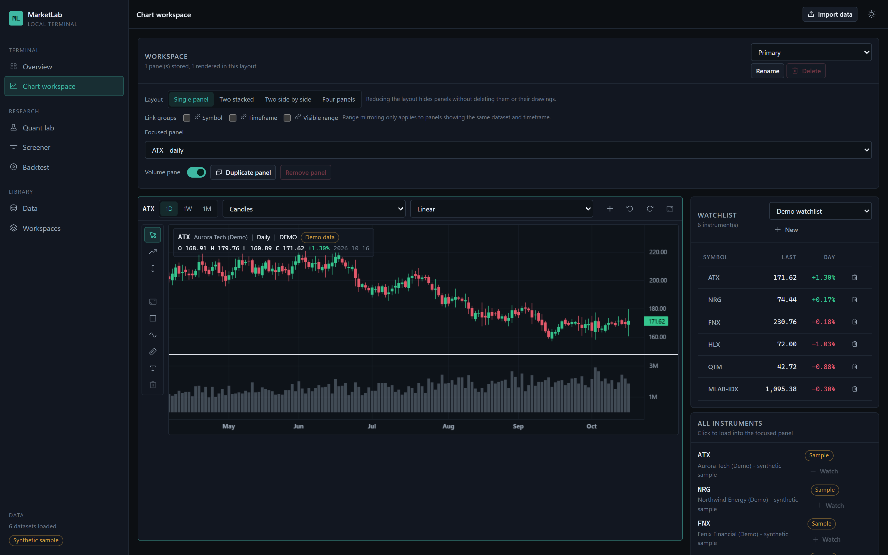
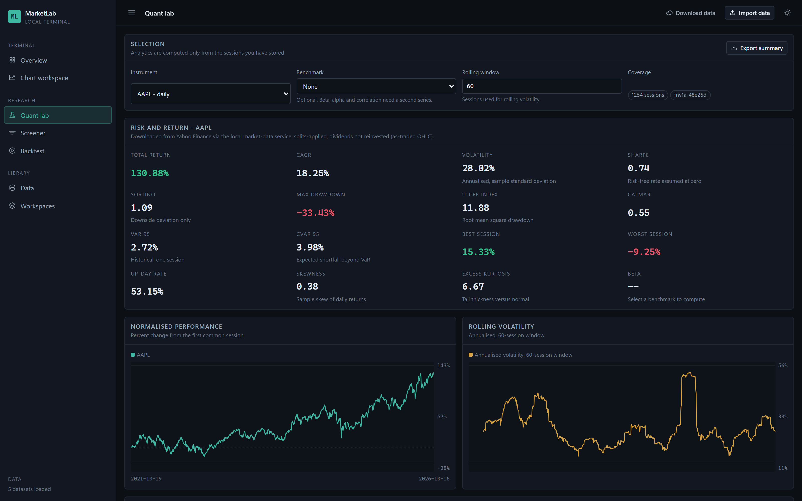
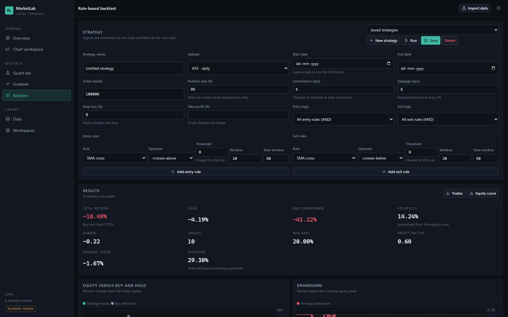

# MarketLab

**A local-first charting and quantitative research terminal that runs entirely in your browser.**

[Live application](https://marketlab.sourabhpradhan.in) · [Features](#features) · [Screenshots](#screenshots) · [Getting started](#getting-started) · [Getting data](#getting-data) · [Data and provenance](#data-and-provenance) · [Architecture](#architecture) · [Testing](#testing) · [Project status](#project-status) · [Scope and limitations](#scope-and-limitations)

MarketLab implements, from first principles, the workflow a professional charting terminal gives
you: validated OHLCV ingestion, interactive charts with indicators and drawings, risk and
cross-asset research, historical screening, rule-based backtesting, and export or backup of
everything you have stored. It is a static single-page application with a same-origin serverless
proxy for downloads — there is no account, no analytics or telemetry, and every calendar,
indicator and simulation is computed on your own device. Your library lives in the browser's
IndexedDB and is never uploaded anywhere.

**MarketLab ships no bundled market data.** The library starts empty and fills with history you
download through the hosted data proxy (or the optional local service during development) or
import from a CSV file. Nothing is synthesised, and no price is ever invented to fill a gap.

MarketLab is an independent project. It is not affiliated with, endorsed by, or derived from
TradingView or any other commercial charting platform; it reimplements a familiar terminal
*workflow* from scratch.



## Contents

- [Features](#features)
  - [Charting](#charting) · [Indicators](#indicators) · [Research](#research) · [Data](#data) · [Workspace](#workspace) · [Navigation and reference](#navigation-and-reference)
- [Screenshots](#screenshots)
- [Getting started](#getting-started)
- [Getting data](#getting-data)
- [Data and provenance](#data-and-provenance)
- [Architecture](#architecture)
- [Testing](#testing)
- [Hosting](#hosting)
- [Project status](#project-status)
- [Scope and limitations](#scope-and-limitations)

## Features

### Charting

- Candlestick, OHLC bar, line, area and baseline series, with a volume pane and normal,
  logarithmic or percentage price scales.
- Crosshair readout showing OHLC, change and session date for the bar under the pointer.
- Layouts of one, two stacked, two side by side or four panels. Link groups keep panels in step for
  symbol, timeframe, visible range or crosshair; a linked crosshair follows the hovered session (or
  its week or month) into any panel that has a bar for it. Reducing a layout hides panels without
  deleting them or their drawings.
- Drawing tools: trend line, ray, horizontal level, vertical marker, zone rectangle, Fibonacci
  retracement, measure move and text label — with drag-to-move, undo/redo (`Ctrl`/`Cmd`+`Z`,
  `Shift` to redo) and `Delete` to remove a selection. Shortcuts apply only to the focused chart
  and never while a dialog or a text field has focus. Hit-testing matches what is painted:
  hidden drawings cannot intercept the pointer, locked drawings stay selectable but immovable,
  a text label is selectable across its painted box, and a level with a single anchor is
  selectable along its whole line.
- **Saved chart templates** — save the chart type, price scale, volume pane, timeframe and ordered
  indicator set from any panel, then apply it here or on another panel. Applying a template
  replaces only those properties, in one write: the destination dataset, instrument, visible
  range, comparisons and drawings are preserved, and the template is not part of drawing undo.
- **Comparison overlays** — add other stored series to a panel as rebased index lines on a
  separate left axis. Series are aligned on real shared sessions and rebased to 100 at the first
  common session; nothing is forward-filled. The legend removes one series or clears all, and the
  panel foot states the method and any excluded series with reasons.
- **Corporate-action markers** — provider-reported splits and dividends from downloaded history
  are marked on the primary series: splits above the bar, cash dividends below. Yahoo Finance
  supplies these events; the optional Twelve Data fallback does not, so its downloads show no
  markers. The panel names the provider and states that prices are already split-adjusted (so a
  split marker is not a price gap) and that dividends are not reinvested. Imported CSVs and older
  downloads show no markers rather than guessed events.

### Indicators

Twelve indicators, each computed from first principles (no third-party maths library) and
unit-tested against hand-checked values:

- **Trend:** SMA, EMA, ADX, Ichimoku Cloud, Anchored VWAP
- **Momentum:** RSI, MACD, Stochastic Oscillator
- **Volatility:** Bollinger Bands, ATR
- **Volume:** Volume SMA with relative volume, On-Balance Volume

Parameters are clamped to their declared bounds, and outputs that do not exist yet (warm-up
periods) are empty rather than zero.

### Research

- **Quant lab** — total return, CAGR, annualised volatility, Sharpe, Sortino, maximum drawdown,
  Ulcer index, Calmar, historical VaR and CVaR, beta and alpha against a second series, plus a
  normalised performance comparison, rolling volatility, rolling drawdown and a correlation
  matrix over shared sessions. Assumptions (for example, a zero risk-free rate) are printed next
  to the numbers they affect.
- **Screener** — field/operator/value rules evaluated over the sessions you have stored, with the
  matched series, per-row filter columns and a count of how many series were evaluated. A result
  opens in the chart workspace without re-importing it or moving the screen's cutoff.
- **Backtest** — a long-only rule engine with entry, exit, stop-loss and take-profit rules,
  position sizing, commission and slippage, an equity curve against buy-and-hold, a drawdown
  chart and a trade log you can export. Execution assumptions are printed next to the results.
- **Saved research runs** — store an immutable snapshot of a backtest: the configuration, the
  dataset identity and a SHA-256 fingerprint of the exact window, the execution assumptions,
  metrics and trades. Provider-download runs also record the data's source provenance at save
  time: the provider and its declared price adjustment, exchange, currency, timezone, the
  window actually requested, the coverage check against it and the retrieval date. Runs saved
  before this existed (and runs on imported CSVs) show "Not recorded" rather than invented
  values. Browse runs in a filterable, newest-first library; selecting one opens its
  snapshot. Rename a run's display label at any time: it is metadata only and never alters the
  recorded configuration, dataset fingerprint, assumptions, metrics or trades. Inspect a run
  later, re-run it to verify the outputs, export it as a versioned JSON manifest (no market data),
  or import one. Re-running never overwrites the saved result. If the dataset is gone the run says
  so; if its prices changed the run reports changed inputs and only simulates on today's data when
  you explicitly ask.
- **Compare saved runs** — put any two snapshots side by side: names and dates, recorded metrics
  and absolute deltas, strategy configuration, dataset identity, window, engine version and
  execution assumptions. Input checks hash the saved window without running either strategy, and
  the comparison warns when market data, window, engine or assumptions differ. Deltas are
  descriptive; the comparison never reruns or changes either saved record.

### Data

- **Download real history** — one symbol at a time, or a whole list in one batch of up to 50.
  Symbols are de-duplicated and reported one by one, so a single unavailable ticker never
  discards the rest of the run; **Retry failed** re-requests only the symbols that failed.
- **CSV import** with inferred column roles you can override, a validation report, and rejected
  rows listed with reasons (see [Importing your own data](#importing-your-own-data)).
- **Weekly and monthly views** aggregated from daily bars, always labelled as aggregated. Daily
  data is never interpolated into intraday bars.
- **Provenance** — every downloaded series stores its provider, exchange, adjustment policy,
  retrieval time and provider-reported corporate actions, and shows the source in the data
  library, the inspection panel and the chart legend. If the provider returned less than the
  requested range, the inspection panel and the backtest Results say so.
- **Export and backup** — datasets, quant summaries, screener results, backtest trades and the
  equity curve as CSV; a saved research run as a versioned JSON manifest; the whole workspace,
  including templates and saved runs, as a versioned JSON backup that can be merged into or
  restored over the current state.

### Workspace

Named workspaces with their own panel layouts, watchlists that load an instrument into the
focused panel and show last close, day change, 30-session average volume and a high-low range
shown as a percentage of the low, persisted preferences (including light and dark themes), and a
data library that shows the stored series, their source, frequency, session counts, first and last
session and content hash — with per-series inspection, export and deletion.

### Navigation and reference

- **Command palette** - `Ctrl`/`Cmd`+`K` opens a keyboard-first overlay for the whole
  application. It filters the navigation destinations, runs safe actions (import a CSV, download
  one or many symbols, export a JSON backup, switch theme, open or create a workspace) and
  searches the datasets already stored in the local library. Arrow keys and `Home`/`End` still
  move the selection after `Tab` moves focus to the close button, while `Enter` keeps that
  button's native action; recently opened datasets are remembered, and focus returns to the
  control that opened the palette. It reads the store's in-memory state only, so
  results always match the current library.
- **How it works** - an in-app guide at `/#/learn` that states the conventions behind every
  number: what a stored bar is, total return and CAGR, risk measures, comparison alignment and
  correlation, screen cutoffs, backtest execution and the cases where MarketLab withholds a
  result. It includes a metric reference with formulas you can copy, a CAGR calculator, a
  screen-cutoff drill, a saved-run comparability drill, a four-case rule check and links into the
  screen that applies each convention.

## Screenshots

All screenshots were captured from a real provider download (AAPL, MSFT, NVDA, SPY and QQQ
through the market-data service), so the provenance shown in them - provider, exchange,
adjustment policy and retrieval timestamp — is real rather than illustrative.

**Chart workspace** — the image at the top of this file: daily AAPL bars with the crosshair
readout, volume pane, drawing toolbar and the downloaded instrument list. Five series are stored;
the readout shows the 2026-10-16 session closing at 343.46 on NasdaqGS.

**Quant lab** — risk and return metrics with the provenance note, normalised performance and
rolling volatility. The coverage readout reports 1254 stored sessions for AAPL; assumptions such
as the zero risk-free rate are printed next to the metrics they affect.



**Rule-based backtest** — strategy parameters, results against buy-and-hold, and the trade log
export. The execution model is restated above the results rather than buried in documentation.



## Getting started

Requires **Node.js 20.19+ or 22.12+** (Vite 8) and npm.

```bash
git clone https://github.com/karbburn/MarketLab.git
cd MarketLab
npm install
npm run dev
```

Open the printed URL. The library starts empty on purpose: the first screen offers to download
real market data, to import a CSV file, or to open the chart workspace and read how to get
started. Nothing is pre-filled, and no placeholder prices are shown.

### Scripts

| Script | Purpose |
| --- | --- |
| `npm run dev` | Start the Vite development server on the fixed port 5173. |
| `npm run build` | Type-check with `tsc -b`, then build the production bundle into `dist/`. |
| `npm run preview` | Serve the built bundle locally on the fixed port 4173. |
| `npm run typecheck` | Type-check only. |
| `npm run lint` | Run ESLint over the repository. |
| `npm test` | Run the unit test suite (Vitest). |
| `npm run test:watch` | Run unit tests in watch mode. |
| `npm run test:e2e` | Build the app, then run the Playwright end-to-end suite against the preview server on 127.0.0.1:4173. |
| `npm run verify` | Lint, type-check, unit test and build in one pass. Does not run the E2E or Python service suites. |

## Getting data

### Downloading real history

MarketLab downloads daily bars from Yahoo Finance. Yahoo does not send browser-readable CORS
headers, so the browser cannot call it directly. On the deployed site, requests go to the
same-origin serverless proxy in `api/market-data/`; on `localhost` or `127.0.0.1`, they go to the
optional FastAPI service in `services/market-data/`. Either way, the browser only talks to the
same origin or to loopback.

The hosted proxy can also use Twelve Data as an optional fallback. Set
`TWELVE_DATA_API_KEY` in the Vercel project (Production and Preview) and the proxy will try
Yahoo first, then Twelve Data when Yahoo is throttled, unavailable or has no data for the
symbol. The key is read only on the server; it never appears in the browser bundle, a request
URL or an error message. Without the key the fallback is dormant and failures remain explicit.
Each saved series records the provider that actually answered. The public endpoints are
best-effort rate limited in the handlers themselves: 60 history and 30 search requests per
minute per address, plus a shared global budget for Twelve Data fallback credits (20 per
5 minutes, 200 per 24 hours) that is charged only when a fallback call is really made. Over
the limit a request is refused with HTTP 429 and `Retry-After`. These counters live in the
edge function's warm instance, so they bound accidental load, floods and most scripted abuse;
a distributed attack is bounded only by platform-level rules (Vercel), which remains the
recommended hard control.

The policy is narrower than "anything Yahoo failed to answer". Both free Yahoo hosts are tried
first, including when Yahoo returns a throttling error inside an otherwise successful response.
A rejected window (Yahoo answers HTTP 400 for a range it cannot serve, such as one that starts
before the instrument listed) is reported as *no data* rather than as a service failure, and it
does not spend a paid Twelve Data credit on a second opinion. When both providers fail, the
error only calls a condition shared ("both throttling", "both timed out") when both actually
reported it; otherwise it reports each failure separately.

**Using the deployed site:** open **Data → Download market data** for one symbol, or **Data →
Download many symbols** for a batch of up to 50. No local setup, account or browser permission is
needed. AAPL, MSFT, NVDA, SPY and QQQ are sensible starting points, and the batch dialog accepts
any list you paste in.

**Running locally:** start the local service if you want downloads on localhost:

```bash
cd services/market-data
python -m venv .venv && . .venv/bin/activate   # Windows: .venv\Scripts\activate
pip install -r requirements.txt
python -m uvicorn app:app --host 127.0.0.1 --port 8787
```

Read [`services/market-data/README.md`](services/market-data/README.md) for the endpoints, the
error model and the setup details. In local development the service is optional: without it, CSV
imports, previously downloaded series and every other feature keep working, and download attempts
fail with an explicit message instead of silently producing nothing.

### Importing your own data

CSV import accepts a header row and infers the column roles, which you can override before
importing:

```csv
date,open,high,low,close,volume
2024-01-02,187.15,188.44,183.89,185.64,82488700
2024-01-03,184.22,185.88,183.43,184.25,58414500
```

| Column | Required | Notes |
| --- | --- | --- |
| `date` | yes | Exchange session date; `YYYY-MM-DD` is the canonical form. |
| `open`, `high`, `low`, `close` | yes | Positive prices satisfying `high >= max(open, close)` and `low <= min(open, close)`. |
| `volume` | no | Stored as missing rather than zero when absent. |

Rows are rejected, with the reason reported, when they break an invariant or conflict with the
chosen duplicate policy (`reject`, `keep first` or `keep last`). Out-of-order rows and weekend
sessions are reported as warnings. Missing sessions are reported as gaps rather than invented,
and every stored series carries a content hash that is also used to recognise an already-stored
series when a backup is restored.

## Data and provenance

The rules below are enforced in code, not just in the documentation:

- **Real data or nothing.** No synthetic series ship with the application. An empty library is a
  first-run state with real actions in it, not a gap filled with invented prices. A browser that
  ran an earlier build still holding the old demo series has them removed on load, and only them:
  imported, downloaded and user-created records are left untouched.
- **Sources stated plainly.** Yahoo Finance is an undocumented source. The optional Twelve Data
  fallback is a commercial API whose availability depends on the configured plan and rate limits.
  Either provider's downloads can be delayed, rate limited, or change shape without notice, and
  the data is not licensed for redistribution.
- **Provenance travels with the prices.** Every downloaded series stores its provider, exchange,
  adjustment policy (`splits-applied, dividends not reinvested`), retrieval timestamp and any
  provider-reported split/dividend events. The requested date range is stored too: if a provider
  returns less than was asked for, the pre-save review says so, and the shortfall stays visible in
  the inspection panel and in the backtest Results — including for a strategy with no date
  bounds, where the run's own window would otherwise look complete. The stored OHLC is already
  split-adjusted and dividends are not reinvested; no separate adjusted-close series is stored,
  and nothing is mixed into OHLC computations.
- **Corporate actions are reported, not inferred.** Split and dividend markers come only from the
  provider's action columns. A split marker records the provider event date; because the OHLC is
  split-adjusted, it does not imply a price gap. Dividend markers are cash per share and are not
  reinvested. Actions with no matching displayed session are counted as unmarked rather than
  moved to a nearby bar, and imported CSVs carry no corporate actions at all.
- **Failures are reported, never papered over.** A failed or empty download is shown as such; no
  other series is substituted for it, and nothing is labelled real unless it came from a provider.
- **Validation before storage.** Imported and downloaded series are checked for OHLC invariants,
  duplicate sessions and unorderable rows before they are written, and the reasons for rejected
  rows are shown to you.
- **No timeframe is invented.** Sessions are daily; aggregation is only downward (daily → weekly
  or monthly) and is labelled as aggregated. Nothing infers an intraday series from daily data.

## Architecture

```
src/
  components/     app shell, command palette, UI primitives, chart panels, chart adapter, dialogs
  domain/         canonical domain types (bars, datasets, workspaces, drawings, runs)
  lib/
    backtest/     rule definitions, comparison helpers, simulation engine, saved-run contracts
    chart/        comparison-overlay preparation, chart presentation and template helpers
    command-palette/  palette planning, search, recents and shortcut labels
    corporate-actions.ts  provider-action labels and marker planning
    csv/          CSV parsing and column mapping
    drawings/     drawing geometry and hit testing
    export/       CSV writers, JSON backup and browser download helpers
    indicators/   indicator implementations and registry
    learn/        field-guide content and the guide's example calculations
    marketdata/   provider client, batch queue, response normalisation, Yahoo adapter,
                  optional Twelve Data fallback and hosted fallback policy
    migration/    removal of the legacy bundled demo series
    persistence/  IndexedDB adapter with an in-memory fallback
    quant/        performance, risk, correlation and comparison metrics
    screener/     screener fields and evaluation
    validation/   dataset validation and OHLC invariants
    workspace/    workspace, template and saved-run schemas
  pages/          one module per top-level screen
  state/          store, defaults, selectors
  styles/         design tokens and global styles
api/
  market-data/    same-origin Vercel edge proxy used by the deployed site
services/
  market-data/    optional local FastAPI + yfinance service and its tests
tests/
  unit/           Vitest suites
  e2e/            Playwright suites
```

**Stack.** React 19 with TypeScript in strict mode, built by Vite 8. Rendering of price panes is
delegated to [`lightweight-charts`](https://github.com/tradingview/lightweight-charts), while
drawings, hit testing and readouts are drawn on a plain canvas overlay that shares the price
pane's coordinate space. Boundaries — imported backups, CSV rows, download responses — are parsed
with Zod and rejected with an explanation rather than coerced. Styling is plain CSS over a small
set of design tokens, with dark and light themes.

**Decisions worth knowing.**

- **Canonical bars.** A session is identified by its date (`YYYY-MM-DD`), bucketed in UTC. Only
  daily → weekly (Monday-based) and daily → monthly aggregation is offered; intraday is
  unsupported by design, and nothing infers an intraday series from daily data.
- **Deterministic maths, explicit gaps.** Indicators, metrics and the backtester are pure
  functions over stored bars, with warm-up periods reported as empty rather than zero.
- **A disclosed execution model.** Signals are evaluated on a session's close and orders fill at
  the next session's open — no same-bar fill, no look-ahead. Costs and slippage apply to both
  sides; when a bar touches both the stop and the target, the stop is assumed to fill first; a
  position still open at the end is closed at the last session and labelled end-of-data.
- **Local-first persistence.** The store writes to IndexedDB through a serialised per-record
  write queue, and falls back to in-memory storage (saying so) when IndexedDB is unavailable.
  Exports and backups exist so a durable copy is always a click away.
- **Hash routing.** Routes are served from the fragment, so the production build is a directory
  of static files that needs no server rewrite rules. Every screen has a stable address (for
  example `/#/chart`, `/#/learn` and `/#/data`). The Vercel deployment adds the download proxy
  under `/api/market-data`; a purely static host still runs every other feature.

## Testing

```bash
npm run verify                     # lint, type-check, unit tests, production build
npm run test:e2e                   # builds, then Playwright on 127.0.0.1:4173
python -m pytest services/market-data/tests -q
```

`npm run verify` covers lint, type-check, the unit suite and the production build only. It does
**not** run the browser suite or the Python service suite. E2E (`npm run test:e2e`, which builds
first) and pytest are separate required gates: a change is verified only when all three commands
pass.

Suite sizes are not hardcoded here because they change with every commit; the commands above are
the source of truth.

| Suite | Gate | What it covers |
| --- | --- | --- |
| Unit (Vitest) | `npm test` | Indicator values, OHLC validation and CSV mapping, risk metrics and correlation, comparison alignment and rebasing, corporate-action validation and marker planning, screener evaluation, the backtest fill model, saved research-run fingerprints, label-only renaming, verification states, comparison semantics and manifests, chart templates and drawing hit-testing, the download batch queue, symbol token handling, watchlist context maths, backup parsing, the legacy-series removal, export formatting, command-palette search and recents, the field guide's calculations and comparability verdicts, and the documented route, data and build-config claims. |
| End-to-end (Playwright) | `npm run test:e2e` | The shell and navigation, the command palette, the chart workspace, chart templates, comparison overlays and corporate-action markers, every drawing tool with the anchors it stores, typing and editing a label, keyboard drawing shortcuts, watchlist context columns, CSV import and rejection paths, the research screens, saving/reloading/verifying/exporting/importing a research run, filtering and renaming in the saved-run library without changing the recorded snapshot, comparing two saved runs without changing either record, the field guide and its interactive drills, settings, backup export/restore, the single and batch download success, failure, retry and symbol-suggestion paths, first-run guidance and the migration. |
| Service (pytest) | `python -m pytest services/market-data/tests -q` | Success, invalid parameters, empty results, unknown symbols, corporate-action extraction and filtering, throttling, timeouts, malformed responses, caching, CORS and search normalisation - deterministic, never touching the network. |

The end-to-end suite drives the built app with the locally installed Google Chrome
(`channel: 'chrome'`, no browser download) and seeds its own library, because the application
bundles no data. The download paths stub the provider, so the suite does not depend on Yahoo
Finance, Twelve Data or the local service being reachable.

## Hosting

`npm run build` produces a static `dist/` directory. The Vercel deployment also publishes the
edge functions in `api/market-data/`, so the deployed bundle and its download proxy share an
origin. Because the app uses hash routing and stores data per browser profile, the static build
can still be served from another host; downloads there need a compatible endpoint configured with
`VITE_MARKET_DATA_URL` (or the runtime `window.__MARKETLAB_MARKET_DATA_URL__` override). Without
one, downloads fail explicitly and CSV import keeps working.

The local FastAPI service is not required by the deployed site. Its CORS whitelist includes the
deployed origin so a developer can still use it from the hosted app when debugging localhost
behaviour.

The hosted proxy needs no account and no persistent server. It runs as Vercel edge functions, so
Render or another always-on backend is unnecessary. To enable the optional fallback, add
`TWELVE_DATA_API_KEY` to the Vercel project's environment variables; the health route at
`/api/market-data/health` then reports `"fallbackProvider": "twelve-data"` without exposing the
key. Yahoo remains the primary source, and the key is never sent to the browser.

## Project status

**Shipped and verified.** The features above, including the global command palette and the
"How it works" field guide, plus a live deployment. Verification is the three gates listed under
Testing - `npm run verify`, `npm run test:e2e` and the pytest command - and their suite sizes move
with every commit, so the commands are the source of truth.

**Planned, not started** - none of the account-free items selected from an internal review of
what a charting terminal offers remain outstanding. The command palette and the field guide both
shipped; anything not listed under Features is not implemented and is not promised here.

**Deliberately out of scope.** MarketLab is an analysis and research tool, not a trading
terminal: no intraday or streaming quotes, no brokerage connectivity, no accounts or cloud sync,
no short selling, no alerting and no replay. These are product decisions, not gaps.

## Scope and limitations

- Sessions are daily; there is no streaming quote feed, no tick data and no intraday timeframe.
- Downloads depend on external providers and can fail; the app reports failures instead of hiding
  them or substituting other data. Twelve Data is an optional fallback, not a guarantee.
- The backtester is long-only, single-position and per-series. It does not model portfolios,
  short selling, borrow costs, dividends or other corporate actions; prices are split-adjusted as
  reported by the provider.
- Corporate-action markers are display annotations sourced from provider metadata. They do not
  change OHLC, indicator inputs, screens or backtest calculations.
- A saved research run identifies its inputs with the dataset content hash and a SHA-256
  fingerprint of the exact window. It can only be reproduced while those bars remain in the
  library: a fingerprint cannot recreate deleted data. Importing a manifest is not a signature
  check, since a hand-edited file can rewrite both the fingerprint and the outputs.
- Re-running a saved run is deterministic for the same engine version, configuration and bars.
  Metrics and trades are compared within an absolute-or-relative 1e-9 tolerance to absorb floating-point
  differences between JavaScript runtimes.
- Saved-run deltas are descriptive. When inputs differ, the comparison warns before the table but
  still shows the recorded values; it does not rerun either strategy, substitute current data or
  present the difference as proof that one strategy is better.
- State is per browser profile. Moving between browsers is done deliberately through the JSON
  backup, not through an account or a sync service.
- Nothing here is investment advice.

---

MarketLab is an independent project, not affiliated with or endorsed by any charting platform or
data provider. No licence is granted for reuse of this source code.
